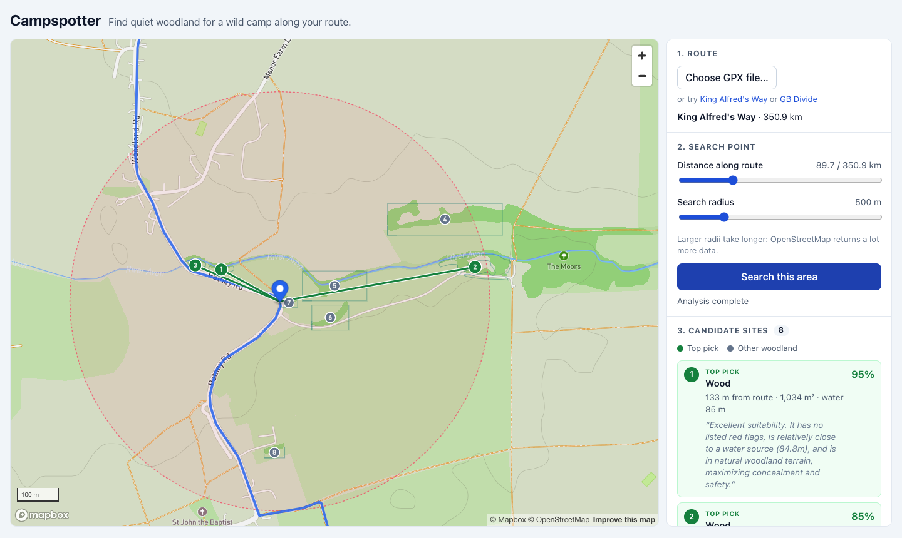
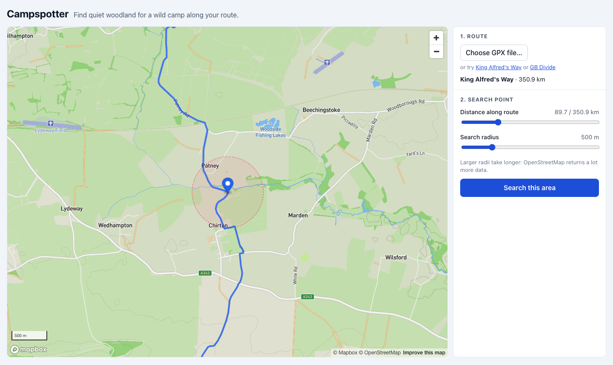
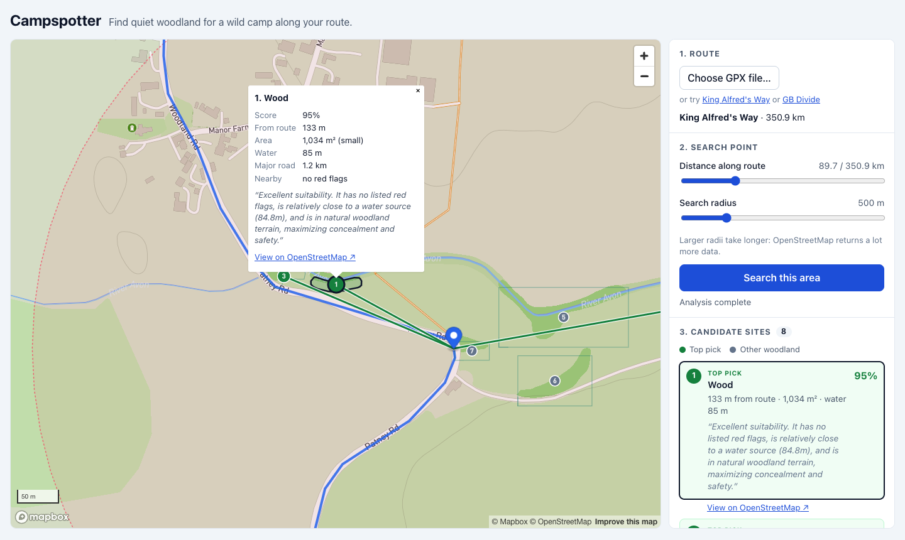

# Campspotter

Campspotter uses OpenStreetMap data and an LLM to find suitable wild camping spots along a GPX route.
Pick a point on your route, and it finds nearby woodland, checks each wood for nearby buildings, roads
and water, and asks an LLM to choose the best three.



The app has two parts:

- **Front end**: Svelte + Mapbox GL (this folder)
- **Back end**: a Python FastAPI server that queries OpenStreetMap and the LLM ([`server/`](server/README.md))

## Quick start

1. **Mapbox token.** Copy `.env.example` to `.env` and set `VITE_MAPBOX_TOKEN`. To create a token, register
   at Mapbox and go to <https://console.mapbox.com/account/access-tokens/>.
2. **Start the server** (needs [uv](https://docs.astral.sh/uv/)):
   ```bash
   cd server
   uv sync
   uv run python server.py
   ```
3. **Start the front end** in another terminal:
   ```bash
   npm install
   npm run dev
   ```
4. Open the URL Vite prints (usually <http://localhost:5173>).

## The LLM

I run the LLM locally using [Ollama](https://ollama.com/). The `server/safe-gemma` Modelfile uses the
`gemma4:e2b` model with a context size of `8192`, which runs happily on my 8 GB MacBook Air:

```bash
cd server
ollama create safe-gemma -f safe-gemma
ollama run safe-gemma --keepalive 30m
```

To use that profile, set `OLLAMA_MODEL=safe-gemma` in `server/.env`. To use Gemini instead, set
`LOCAL_LLM_ENABLED=false` and `GEMINI_API_KEY=...`. If no LLM is reachable (or it replies with
unusable JSON twice), the server still works: it falls back to a simple built-in scoring heuristic. See [`server/.env.example`](server/.env.example) for
all the settings.

## How to use

1. Load a GPX file, or click one of the bundled samples: the
   [King Alfred's Way](https://www.cyclinguk.org/king-alfreds-way) (350 km) or the GB Divide (1,980 km).
2. Use the **Distance along route** slider to choose where you want to camp. The slider works with the
   keyboard (arrow keys) too.
3. Optionally change the **Search radius** (default 500 m). Larger values are slower, because
   OpenStreetMap returns a lot more data.
4. Click **Search this area**.

Results stream in as each stage finishes:

1. **Discover.** Fetch woods and forests, plus "red flags" (buildings, barriers, schools, railways, car
   parks...), from OpenStreetMap via the Overpass API.
2. **Summarise.** Work out each wood's size, its distance from the route, and the red flags within
   150 m of it.
3. **Enrich.** For the nearest candidates (10 by default), find the distance to major roads and water.
4. **Score.** Ask the LLM to score the candidates against a fixed set of wild camping criteria and
   pick the best three. The reply must be JSON matching a schema; an invalid reply gets one stricter
   retry, then the built-in heuristic takes over.
5. **Outline.** Fetch the full outline of the three top picks from OpenStreetMap.

Top picks are shown in green and numbered on the map. Click a site in the list or on the map to zoom to
it and see its details, including a link to it on OpenStreetMap.

Everything works from the keyboard and with a screen reader: a "Skip to route and search" link jumps
past the map's controls, the sliders announce their values with units, and each site in the list
carries the same details as its map popup. Map animations are skipped if your system asks to reduce
motion.





## Development

```bash
npm test                          # front-end tests (Vitest + Svelte Testing Library)
npm run check                     # type check (svelte-check + TypeScript)
npm run lint                      # lint (ESLint)
npm run build                     # production build into dist/

cd server
uv run pytest                     # back-end tests (pytest)
uv run ruff check . && uv run ruff format .   # lint and format
uv run mypy                       # type check
```

Front-end code lives in `src/`: state and actions in `lib/stores.ts`, the websocket client in
`lib/searchClient.ts`, all Mapbox code in `lib/map/`, and the UI in `components/`. The server's layout is
described in [`server/README.md`](server/README.md).

The back-end tests never touch the network. They use a captured Overpass response in
`server/tests/fixtures`, plus fakes for the LLM.

Map data © [OpenStreetMap contributors](https://www.openstreetmap.org/copyright).
